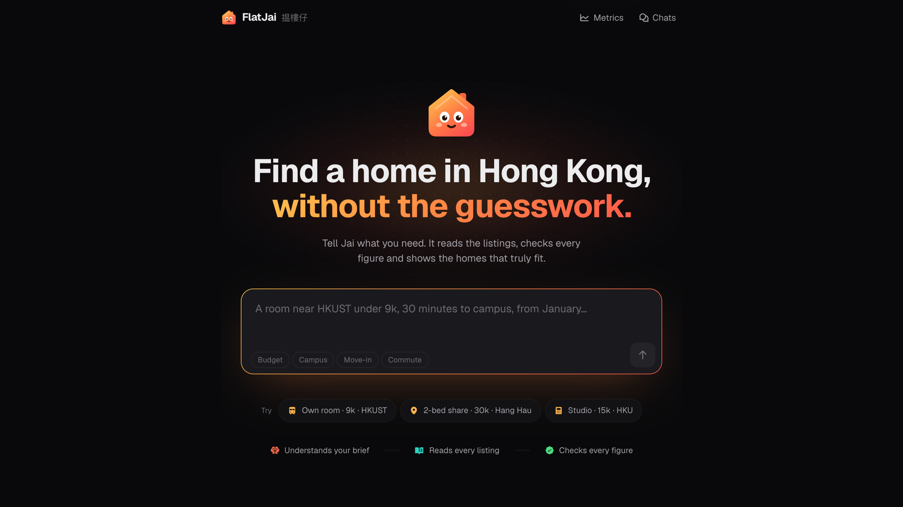
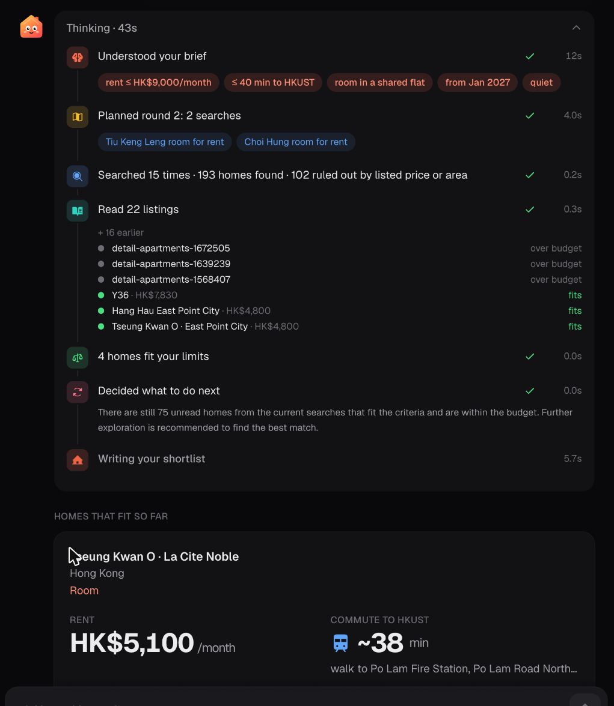
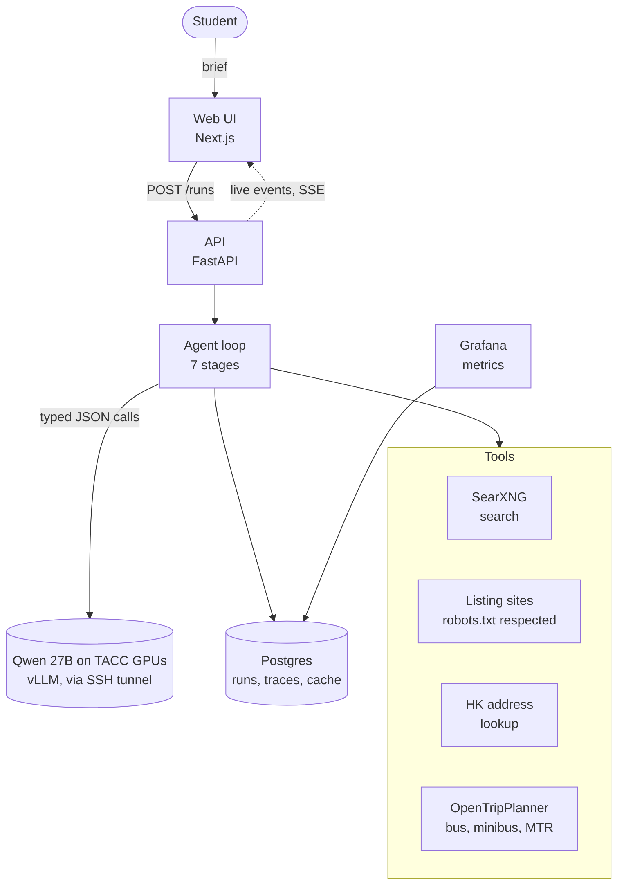
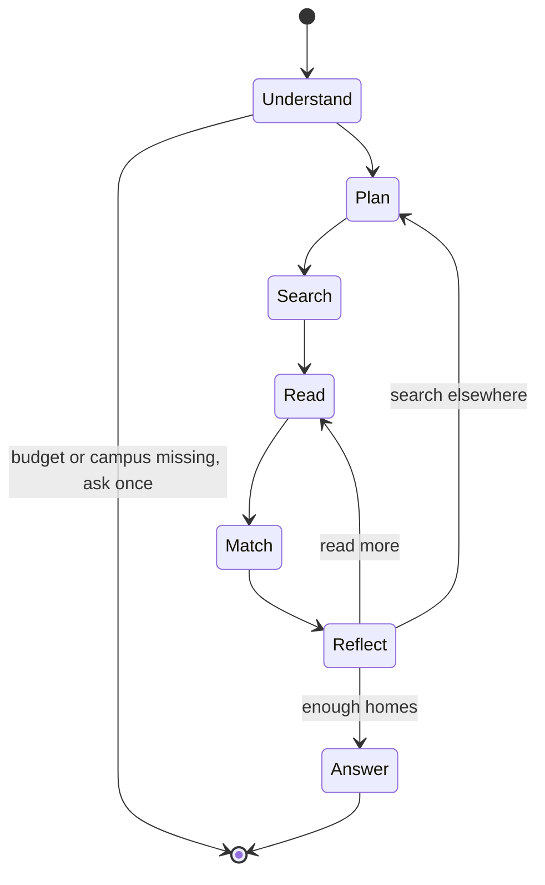
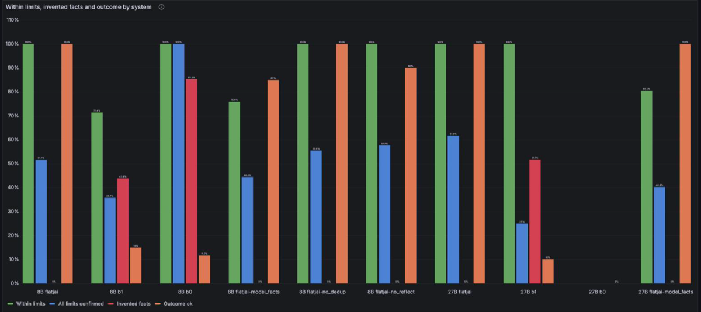

# FlatJai (揾樓仔)

**An AI agent that finds a home in Hong Kong for a student, and never makes up a number.**

A student writes what they need in plain words: *"Own room, max HK$9,000 a month, under 40 minutes
to HKUST, from January."* FlatJai searches the listing sites, reads each listing, and returns a
short list of real homes. Each one shows its true monthly and move-in cost, the commute to campus
on an actual bus and MTR route, where the listing came from, and why it fits.

<table>
  <tr>
    <td colspan="2"></td>
  </tr>
  <tr>
    <td colspan="2">Write what you need in plain words, or start from an example.</td>
  </tr>
  <tr>
    <td width="50%"></td>
    <td width="50%"></td>
  </tr>
  <tr>
    <td>Every step is streamed live while it reads the market. Here on Qwen 27B on TACC: 19 s for this brief.</td>
    <td>A result: rent, real cost to move in, the route to campus, and which of your limits it meets.</td>
  </tr>
</table>

Built for CSIT6000V (Advanced AI Computing and Systems, HKUST, Fall 2026). FlatJai's model is
**Qwen3.8-27B served on TACC GPUs**: the app runs on your machine and reaches the model through an
SSH tunnel, and the evaluation runs as a TACC job next to it. Without TACC access, Qwen3 8B on your
own machine can stand in.

**Want to try it?** See [Quick start](#quick-start) and [Using FlatJai](#using-flatjai).
**Reviewing the evaluation?** [Getting Started Instructions](#getting-started-instructions) sets it
up and checks one brief end to end in about 30 minutes; [Detailed Instructions](#detailed-instructions)
reruns the experiments and compares them with the reported results.

## Quick start

```bash
git clone https://github.com/BhanuRana/flatjai.git
cd flatjai
./setup.sh        # asks where the model runs: TACC (recommended) or this machine
./run.sh app      # then open http://localhost:3000
```

You need Docker, uv, Node.js 20.9 or newer and zstd; `setup.sh` checks each one and tells you how to
install anything missing. For Qwen 27B on TACC you also need a TACC account for the course, tcloud
and the HKUST network or VPN ([docs/tacc.md](docs/tacc.md)). Install steps for macOS, Linux and
Windows are under [Prerequisites](#prerequisites).

## Why you can trust its answers

The model makes the decisions (what the student means, where to look, what to read next, how to
explain the choice). **The facts come from tools, and code checks them:**

- every rent, size and address must be quoted from the listing page it came from;
- the monthly and move-in costs are computed by code (deposit, first month, agent fee);
- commutes are real journeys from OpenTripPlanner over Hong Kong's bus, minibus and MTR data;
- "fits your budget" and "under 40 minutes" are decided by code, never by the model;
- any sentence in the explanation whose number is not one of that home's facts is removed.

We measured this on a frozen snapshot of the market: 20 student briefs in 7 categories, each answer
checked by a separate program (`eval/score.py`, not the agent's own checks and not a person). The
results support four claims:

| | Claim | Evidence |
|---|---|---|
| **C1** | FlatJai shows no invented facts (0%) and keeps every shown home within the student's limits (100%), while the model alone invents 85% of its facts and one search plus an answer invents 44%. | E1, Table 1 |
| **C2** | The tools carry the honesty: letting the model state costs and commutes puts 24% of shown homes over a limit and understates every move-in cost. Reflection and de-duplication add smaller gains. | E2, Table 2 |
| **C3** | C1 and C2 hold on a larger model: Qwen 27B on TACC also shows 0% invented facts and 100% within limits. | E3, Table 3 |
| **C4** | A brief takes a median of 19 s on TACC (27B), under the 90 s target, and 26 s even on a laptop (8B). | Tables 3 and 1 |

| | Invented facts | Homes within the student's limits | Brief handled well |
|---|---|---|---|
| The model alone (B0) | 85% | 100% (of 35 homes, mostly invented) | 12% |
| One search, then answer (B1) | 44% | 71% | 15% |
| **FlatJai, Qwen 27B on TACC** | **0%** | **100%** | **100%** |
| **FlatJai, Qwen 8B on a laptop** | **0%** | **100%** | **100%** |

## How it works



Each brief runs through seven stages. The run is saved after every stage, so it can resume after
a crash, and the browser can reconnect without losing anything.



| Stage | What happens |
|---|---|
| Understand | The brief becomes a typed profile. If the budget or campus is missing, the agent asks one question. |
| Plan | The model picks areas and search terms within reach of the campus. |
| Search | SearXNG finds listing pages on sites FlatJai is allowed to read. |
| Read | Each page is fetched politely, the listing extracted with a quote for every field, the quotes checked against the page, the cost computed and the commute routed. |
| Match | Code checks every hard limit and removes duplicates listed on several sites. |
| Reflect | Enough good homes? If not, read more or search somewhere else. |
| Answer | The model ranks and explains; code removes any claim it cannot back. |

The full design (data flow, storage, resume, tracing, code map) is in
[docs/architecture.md](docs/architecture.md).

---

# Using FlatJai

## Start it

```bash
./run.sh app                  # the app, on the model chosen at setup (Ctrl-C stops it)
./run.sh app --offline        # the same, answering from the frozen snapshot only
./run.sh app --model local    # this run on Qwen 8B here, whatever setup chose
./run.sh suite                # the evaluation suite on Qwen 27B inside TACC
```

`./run.sh app` starts the Docker services, the model's TACC job and its tunnel (about 5 minutes,
or reuses an open tunnel), the API and the web app in one terminal (`make app` does the same).
Ctrl-C stops all of it and cancels the TACC job. To run the API and the web app in separate
terminals instead, open the tunnel with `scripts/tacc-tunnel.sh`, then use `make dev` and `make web`.

| Open | What |
|---|---|
| http://localhost:3000 | FlatJai: write a brief, or tap one of the examples |
| http://localhost:3001 | Metrics dashboard (Grafana, no login) |
| http://localhost:8000/docs | API reference |

Stop the Docker services with `make down`; your data stays in the Docker volume.

## Models

The model is chosen by `FJ_MODEL` in `.env` (`./setup.sh` sets it), from the profiles in
`backend/models.yaml`:

| Profile | Model | Where |
|---|---|---|
| `tacc-tunnel` (default) | Qwen3.8-27B, AWQ INT4, 32K context | vLLM on TACC GPUs, forwarded to `localhost:8001`: [docs/tacc.md](docs/tacc.md) |
| `tacc` | the same | from inside a TACC job (`./run.sh suite`) |
| `local` | Qwen3 8B, 16K context | Ollama on your machine (`make model` builds it); the fallback without TACC |

Any OpenAI-compatible server works (LM Studio, vLLM, llama.cpp server): add a profile with its
`base_url` and `model`, and set `FJ_MODEL` to its name. `make check-model` confirms the model returns
valid structured output.

## See what the agent did

Every stage, model call and tool call is recorded. Open **Inspect** on any answer to see one run.
This one is the brief above on Qwen 27B on TACC: 19 s, 5 model calls, with the pages already read
once (its first run, which fetched and read every page, took 76 s with 19 model calls):


The **Metrics** dashboard (Grafana, http://localhost:3001) covers every run, with Qwen 8B and 27B
side by side: outcomes, time per brief and per stage, model and tool latency, cache hits, and the
scored evaluation.


Figure 1, the evaluation at a glance:



## Commands

| Command | What it does |
|---|---|
| `./setup.sh` | Everything from a fresh clone (safe to rerun) |
| `./run.sh app` / `make app` | The app: services, the model (TACC job and tunnel, or Ollama), API and web in one terminal (`--offline` / `OFFLINE=1`: snapshot only; `--model tacc\|local` / `MODEL=`) |
| `./run.sh suite` / `make suite` | The suite on Qwen 27B inside TACC, scored and loaded into the dashboard |
| `scripts/tacc-tunnel.sh` | Start the 27B service on TACC and keep it forwarded to `localhost:8001` until Ctrl-C |
| `make up` / `make down` | Start or stop Postgres, SearXNG, Grafana (and OpenTripPlanner once built) |
| `make dev` / `make web` | API on :8000 with reload / app on :3000 |
| `make test` | 194 tests: no model, network or database needed |
| `make lint` | Ruff, ESLint and TypeScript |
| `make check-model` | The active model returns a valid typed reply |
| `make eval` / `make ablate` | The suite on the snapshot; ablations |
| `make eval-score` | Rescore the latest offline result of each system |
| `make obs` | Load TACC runs and evaluation scores into the dashboard |
| `make otp-graph` | Rebuild the transit graph (~2 min) |
| `make snapshot` / `make snapshot-import` | Freeze the current cache / load a snapshot |

---

# Getting Started Instructions

Goal: set FlatJai up from a fresh clone and run one brief end to end on the frozen snapshot, in
about 30 minutes of hands-on time. Most of the wait is Docker images, the transit graph and starting
the model's GPU job on TACC (about 5 minutes). Nothing here contacts a listing site.

## Where the model runs

`./setup.sh` asks once and remembers the answer in `.env` (`FJ_MODEL`):

| | Model | Needs | Use it |
|---|---|---|---|
| **1. TACC** (recommended) | Qwen3.8-27B, AWQ INT4, on 2 GPUs (vLLM) | a TACC account for the course, [tcloud and the course kit](docs/tacc.md), the HKUST network or VPN | always, when you have access: it is the model FlatJai is built and evaluated for |
| 2. This machine | Qwen3 8B through Ollama | ~5 GB download, 16 GB RAM | only without TACC access |

With TACC, `./run.sh app` starts the course's 27B service as a TACC job, forwards it to
`localhost:8001` through the TACC SSH gateway as you, and cancels the job when you stop. Everything
else (Postgres, SearXNG, OpenTripPlanner, the API and the web app) runs on your machine.

## Prerequisites

| | Minimum | Notes |
|---|---|---|
| OS | macOS, Linux, or Windows 11 with WSL2 | On Windows everything runs inside WSL2 (Ubuntu) |
| Memory | 8 GB RAM (16 GB with the model here) | Docker needs ~6 GB with the route planner; the 8B model another ~6 GB |
| Disk | ~10 GB free (+5 GB with the model here) | Docker images, the Hong Kong map and transit data |
| GPU | none here | The model runs on TACC's GPUs |
| Network | the HKUST network or VPN for TACC | The listing sites are not needed: the evaluation runs offline on the snapshot |

Software: [Docker](https://docs.docker.com/get-docker/), [uv](https://docs.astral.sh/uv/),
[Node.js](https://nodejs.org) 20.9 or newer, zstd and git. For the model on TACC: tcloud and the
course kit ([docs/tacc.md](docs/tacc.md), one-time setup). Only for the model on this machine:
[Ollama](https://ollama.com).

<details open>
<summary><b>macOS</b> (with Homebrew)</summary>

```bash
brew install --cask docker        # then open Docker Desktop once
brew install uv node zstd git
brew install ollama               # only for the model on this machine
```
</details>

<details>
<summary><b>Linux</b> (Ubuntu or Debian)</summary>

```bash
# Docker Engine: https://docs.docker.com/engine/install/ubuntu/ , then let your user run it:
sudo usermod -aG docker $USER && newgrp docker
sudo apt update && sudo apt install -y zstd git curl
curl -LsSf https://astral.sh/uv/install.sh | sh
# Node 20.9 or newer: https://nodejs.org/en/download
curl -fsSL https://ollama.com/install.sh | sh    # only for the model on this machine
```
</details>

<details>
<summary><b>Windows</b> (WSL2)</summary>

1. In PowerShell as administrator: `wsl --install -d Ubuntu`, then restart.
2. Install [Docker Desktop](https://docs.docker.com/desktop/setup/install/windows-install/) and turn on
   *Settings > Resources > WSL integration* for Ubuntu.
3. Open the Ubuntu terminal and follow the **Linux** steps above, skipping Docker Engine.
4. Clone the repository inside WSL (for example in `~/flatjai`), not under `/mnt/c`: it is much faster.
</details>

## Setup (one command)

```bash
git clone https://github.com/BhanuRana/flatjai.git
cd flatjai
./setup.sh
```

`setup.sh` first asks where the model runs (press Enter for TACC). It checks every tool and tells
you how to install anything missing. It then:

1. writes `.env` with your choice (`FJ_MODEL=tacc-tunnel` for TACC, `local` for this machine);
2. installs the Python and web dependencies;
3. starts Postgres, SearXNG, OpenTripPlanner and Grafana in Docker;
4. loads the frozen market snapshot (`data/snapshot-2026-11-20.tar.zst`, 460 listing pages);
5. builds the Hong Kong transit graph (~2 min);
6. for TACC: checks tcloud, your TACC login, the course kit and that the TACC gateway answers. For
   this machine: downloads Qwen3 8B (~5 GB) and checks that it returns valid structured output;
7. runs the tests.

It is safe to run again (rerun it to switch where the model runs), and it never overwrites your
database. It ends with `FlatJai is set up.` and the test line `194 passed`.

| Options | |
|---|---|
| `./setup.sh --model tacc` / `--model local` | Choose without the question (for scripts). |
| `./setup.sh --no-otp` | Skip the route planner (saves ~4 GB of Docker memory). Commutes use an MTR-based estimate, so commute minutes differ from the reported runs. |

## A small end-to-end example

**Step 1. Tests** (no model, network or database needed, ~20 s):

```bash
make test
```

Expected: the last line reads `194 passed`.

**Step 2. Start the model on TACC** (about 5 minutes; skip with the model on this machine). In a
second terminal, leave this running:

```bash
scripts/tacc-tunnel.sh
```

Expected: `[tunnel] service job <id> submitted`, then `still loading (N min)` lines, then
`[tunnel] ready: http://localhost:8001/v1 serves qwen3.8-27b`. Ctrl-C there later closes the
tunnel and cancels the GPU job.

**Step 3. One brief through the whole agent, on the snapshot** (~1 minute). The brief is the first
case in the suite: *"Own room, max HK$9,000 a month, under 40 min to HKUST, from January, quiet"*.

```bash
make up                                   # Postgres, SearXNG, OTP and Grafana (setup.sh left them running)
cd backend
FJ_OFFLINE=1 uv run python ../eval/run_suite.py --system flatjai --cases std-hkust-own-room-9k --tag smoke
```

Expected output with TACC (times vary; 27B extracts each page itself the first time it reads it):

```
flatjai on tacc-tunnel (qwen3.8-27b), offline=True, 1 cases x 1 -> eval/results/<stamp>-flatjai-smoke.jsonl
  [0] std-hkust-own-room-9k          67.7s  homes=3
wrote .../eval/results/<stamp>-flatjai-smoke.jsonl
```

With the model on this machine the first line reads `flatjai on local (flatjai-qwen3-8b)` and the
case takes about 37 s.

The agent understood the brief, planned, searched the snapshot, read the listings, checked every
limit and answered with 3 to 5 homes (3 in the reported 27B run, with commutes of 17 to 35
minutes; 4 on 8B).

**Step 4. Score it with the independent checker** (~10 s):

```bash
uv run python ../eval/score.py ../eval/results/*-flatjai-smoke.jsonl --out /tmp/flatjai-smoke.md
```

Expected: the report printed to the terminal shows, for `flatjai`, **Constraint satisfaction
100%**, **Invented facts 0%**, **Invented listings 0%**, **Correct ask/no-ask 100%** and **Outcome
ok 100%**. If you see these, the system works end to end. (`--out` keeps the shipped
`eval/results/report.md` untouched.)

**Step 5 (optional). The app in a browser:**

```bash
cd .. && ./run.sh app --offline           # services, API and web in one terminal; Ctrl-C stops
```

It reuses the tunnel from step 2 if it is still open; otherwise it starts the TACC job itself.

Open http://localhost:3000 and tap one of the example briefs. Expected: the stages tick by live
(Understood, Planned, Searched, Read N listings), and within about a minute a shortlist of cards
appears, each with rent, move-in cost, commute and the limits it meets. **Inspect** on the answer
shows every stage, model call and tool call of the run.

---

# Detailed Instructions

## Experiments and where their results are

FlatJai's model is Qwen3.8-27B on TACC, evaluated in E3. E1 and E2 were run with Qwen3 8B on a
16 GB laptop: the same suite, snapshot and scorer, showing that the design (tools for facts, checks
in code) does not depend on a large model. Every experiment runs on either model (`FJ_MODEL`).

| Experiment | Supports | What it runs | Command | Time | Output | In the report |
|---|---|---|---|---|---|---|
| **E3** 27B on TACC | C3, C4 | FlatJai, B1, B0 and `model_facts` on Qwen3.8-27B, inside a TACC job | `./run.sh suite` | ~15 min plus queueing | `eval/results/report-tacc.md` | Table 3 |
| **E1** systems | C1, C4 | B0, B1 and FlatJai over the 20 briefs | `make eval` (`REPEAT=3` as reported) | ~15 min per repeat on 8B | `eval/results/report.md` | Table 1, Figure 1 |
| **E2** ablations | C2 | FlatJai with one part off: `no_reflect`, `no_dedup`, `model_facts` | `make ablate` | ~30 min on 8B | `eval/results/report.md` (E1 and E2 in one table) | Table 2, Figure 1 |
| Understand stage | (seed check) | briefs to expected profile fields | `make eval-understand` | ~2 min | terminal | – |

Table 1 is the E1 table in [docs/evaluation.md](docs/evaluation.md), Table 2 the E2
table ("E2 results"), Table 3 the E3 table, and Figure 1 is `docs/images/quality.png` (within
limits, invented facts and outcome for every system and ablation, on 8B and 27B). The full tables
with 95% bootstrap intervals and per-category breakdowns are in `eval/results/report.md` and
`eval/results/report-tacc.md`. Failures found during development, each with its fix and a
before/after measurement, are in [docs/failure-analysis.md](docs/failure-analysis.md).

## Test cases

`eval/suite.yaml` holds 20 reviewed briefs in 7 categories: standard requests (6), missing
information (3), impossible requests (3), Chinese and mixed-language briefs (3), ambiguous
locations (2), an adversarial brief (1) and multi-turn refinements (2). Each case lists the turns
the student types, the student's hard limits as we read them (`truth`) and what a good answer does
(`expect`). Cases 21 to 50 are drafts (`status: draft`), not yet reviewed or in the snapshot;
`make eval` skips them.

## Data

`data/snapshot-2026-11-20.tar.zst` (9 MB) is a frozen copy of the market: every listing page,
search result, extraction, geocode and OpenTripPlanner journey FlatJai cached during one live pass.
`make snapshot-import` loads it into Postgres (`setup.sh` does this once). With `FJ_OFFLINE=1`
FlatJai reads only this cache: no listing site is contacted, and every run sees the same market.
The raw run files behind every reported number are in `eval/results/*.jsonl`.

## Configuration

| Setting | Where | Reported runs | Meaning |
|---|---|---|---|
| `FJ_MODEL` | `.env` (set by `setup.sh`) | `tacc` inside the TACC job (E3), `local` (E1, E2) | Model profile from `backend/models.yaml`; `tacc-tunnel` is the default |
| `FJ_OFFLINE` | set by `make eval` / `make ablate` | `1` | Snapshot only |
| `RUN_MAX_SECONDS` | `.env` | 240 | Time budget per brief |
| `OTP_URL` | `.env` | `http://localhost:8080` | Real journeys; unset means the MTR estimate |
| `SYSTEMS` | `make` variable | `b0 b1 flatjai` | Which systems `make eval` runs |
| `REPEAT` | `make` variable | 3 for E1, 1 for E2 and E3 | Repeats of the suite |
| `ABLATIONS` | `make` variable | `no_reflect no_dedup model_facts` | Which parts `make ablate` switches off |

Model profiles: `tacc-tunnel` is Qwen3.8-27B (AWQ INT4, 32K context, thinking off) on the course's
vLLM service, reached from your machine through the tunnel; `tacc` is the same service from inside a
TACC job; `local` is Qwen3 8B (16K context, thinking off) on Ollama, built by `make model`. All
systems in an experiment use the same profile, so each comparison is about the system, not the
model. With `tacc-tunnel`, keep `scripts/tacc-tunnel.sh` running while `make eval` or `make ablate`
runs (they stop with a hint if it is not).

## Reproduce the results, step by step

**1. Rescore the shipped runs** (~1 minute; checks the scorer and the snapshot, no model needed):

```bash
cd backend
uv run python ../eval/score.py \
  ../eval/results/20261120-1544-b0-offline.jsonl ../eval/results/20261120-1550-b1-offline.jsonl \
  ../eval/results/20261120-1637-flatjai-offline.jsonl \
  ../eval/results/20261121-0900-flatjai-no_reflect-offline.jsonl \
  ../eval/results/20261121-1022-flatjai-no_dedup-offline.jsonl \
  ../eval/results/20261121-1033-flatjai-model_facts-offline.jsonl --out /tmp/report-e1-e2.md
uv run python ../eval/score.py ../eval/results/2026*-tacc.jsonl --out /tmp/report-tacc.md
```

Expected: the same numbers as `eval/results/report.md` and `eval/results/report-tacc.md`.

**2. Rerun E3 on Qwen 27B** (needs the TACC setup from Getting Started):

```bash
cd ..
./run.sh suite              # bundles FlatJai and the snapshot, starts the vLLM service, runs the
                            # suite inside TACC, downloads and scores the results, cancels the service
```

The suite runs inside TACC as a batch job next to the service, so it does not depend on your
network once submitted. Without TACC access, step 1 rescores the shipped E3 runs.

**3. Rerun E1** (fresh model calls on the snapshot; the reported tables used Qwen 8B):

```bash
FJ_MODEL=local make eval REPEAT=3      # as reported; REPEAT=1 for a quicker run
make eval                              # the same on 27B, with scripts/tacc-tunnel.sh running
```

**4. Rerun E2:**

```bash
FJ_MODEL=local make ablate             # the three ablations as reported, then one report with E1
SYSTEMS="flatjai-model_facts" ./run.sh suite    # the key ablation on 27B inside TACC
```

**5. Look at the runs** (optional): `make obs` loads the TACC runs and the scored suite into
Grafana at http://localhost:3001, next to your own runs.

## How answers are scored (by code, not by people)

The scorer is a program, `eval/score.py`. It re-checks every answer against the snapshot with its
own code, independent of the agent's own checks, and its rules are pinned by
`backend/tests/test_eval_score.py`:

| Metric | Definition |
|---|---|
| Constraint satisfaction | Shown homes with no limit broken / shown homes. An unknown fact (no bedroom count) is counted separately. |
| All limits confirmed | Shown homes with every limit known and met / shown homes. |
| Invented facts | Shown rents and sizes not on the home's page in the snapshot, plus summary figures that match no card, budget or relaxation / all such figures. |
| Invented listings | Shown homes whose page is not in the snapshot / shown homes. |
| Correct ask/no-ask | The first turn asks a question exactly when the brief is missing something essential. |
| Outcome ok | Enough homes; for an impossible brief, no home that breaks a limit and concrete relaxations. |

## Expected variation

- **The model is not deterministic.** A rerun on the snapshot gives the same market, but the model
  may plan or rank differently. What should hold on every run: invented facts 0%, invented
  listings 0%, constraint satisfaction 100% for FlatJai, and B0 and B1 far worse. Outcome ok,
  "all limits confirmed" (52% reported, interval 40 to 64%) and homes per brief move by a few points.
- **Speed depends on where the model runs.** On TACC the reported median is 19 s per brief inside
  the cluster; through the tunnel add the round trips to Hong Kong's gateway. The 8B figure (26 s)
  is a 16 GB Apple Silicon laptop with cached extractions; slower machines may hit
  `RUN_MAX_SECONDS` on a few briefs (raise it in `.env`, close other heavy apps, restart Ollama).
- **Without OpenTripPlanner** (`--no-otp`) commutes come from the MTR estimate, so commute minutes
  and a few commute-limit decisions differ.
- **27B results** depend on the shared TACC service (4 requests at a time across the course) and
  its queue; times include its load. A service job lasts 1 hour.

## Known limitations

- 20 reviewed briefs, so the intervals are wide (see `eval/results/report.md`). 30 more are drafted.
- Commutes are checked against OpenTripPlanner on open data (MTR times fitted to the timetable in
  `scripts/build_mtr_gtfs.py`), not against journeys timed by hand.
- B0 and B1 commutes are the model's own claims and are scored as claimed.
- "All limits confirmed" is about 50% because many pages do not say whether a home is a room or
  how many bedrooms a flat has; FlatJai shows these as "?" and suggests asking.
- Precision@5 against hand labels and an LLM-judged explanation score are not built.
- A live run (not offline) reads today's listing sites, so its results differ from the snapshot.
  Live mode fetches at most one page every 2 s per site and respects robots.txt.
- Nothing FlatJai runs is destructive: it writes only to its own Docker volume, `.env`,
  `data/blobs` and `eval/results/`.

---

# Reference

## Project layout

```
backend/     FastAPI app and the agent: agent/ (one module per stage), tools/, storage/, tests/
web/         Next.js app: brief, live progress, result cards with maps, run inspector
eval/        query suite, baselines, scorer, results
infra/       SearXNG, OpenTripPlanner, Ollama, Grafana, and the TACC job
scripts/     snapshot export and import, experiment runners, MTR data builders
data/        the frozen market snapshot
docs/        architecture, evaluation, failure analysis, TACC guide, design decisions, build log
```

## Troubleshooting

| Problem | Fix |
|---|---|
| `setup.sh` says a port is in use | Something else holds 5432, 8888, 8080 or 3001. Stop it, or change the left-hand port in `compose.yaml`. |
| Docker crashes or OTP never becomes healthy | Give Docker at least 6 GB (Docker Desktop > Settings > Resources), or run `./setup.sh --no-otp`. |
| `tcloud` hangs, or "the TACC gateway does not answer" | Connect to the HKUST network or VPN, and turn off any other VPN: the gateway only answers HKUST traffic. |
| The tunnel waits a long time for the model | Normal for 4 to 7 minutes while vLLM loads 27B; longer if TACC queues the job (`tcloud ps`). |
| The app stops answering after an hour | The TACC service job lasts 1 hour: Ctrl-C and `./run.sh app` again. |
| `make eval` says Qwen 27B is not reachable | Open the tunnel in another terminal (`scripts/tacc-tunnel.sh`), or run with `FJ_MODEL=local`. |
| Briefs hit the time limit | On the model here: close other heavy apps, restart Ollama, or raise `RUN_MAX_SECONDS` in `.env`. Tokens per second are on the dashboard. |
| The app shows "Lost the connection" | `make dev` is not running, or stopped with an error: check its terminal. |
| Old styles after pulling changes | Stop `make web`, run `rm -rf web/.next`, start it again. |

## Documentation

- [Architecture](docs/architecture.md): the system, one run end to end, the agent loop, where each fact comes from
- [Evaluation](docs/evaluation.md): suite, baselines, snapshot, metrics, results of E1, E2 and E3
- [Failure analysis](docs/failure-analysis.md): what went wrong during development and the fix for each
- [TACC](docs/tacc.md): Qwen 27B on the course GPUs: one-time setup, the app through a tunnel, the suite (E3)
- [Design decisions](docs/decisions/): one short record per decision (0010: why the model runs on TACC)
- [Build log](docs/build-log.md): dated development journal
