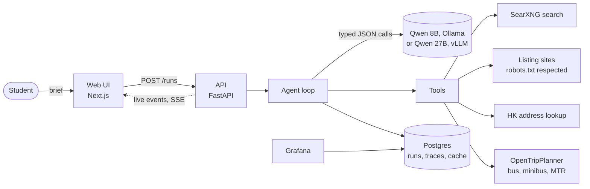
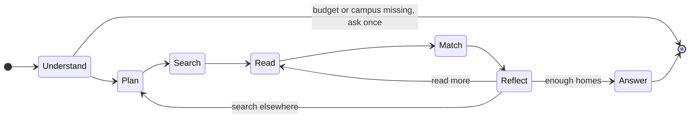

# FlatJai (揾樓仔)

**An AI agent that finds a home in Hong Kong for a student, and never makes up a number.**

A student writes what they need in plain words: *"Own room, max HK$9,000 a month, under 40 minutes
to HKUST, from January."* FlatJai searches the listing sites, reads each listing, and returns a
short list of real homes. Each one shows its true monthly and move-in cost, the commute to campus
on an actual bus and MTR route, where the listing came from, and why it fits.

<table>
  <tr>
    <td width="50%"></td>
    <td width="50%"></td>
  </tr>
  <tr>
    <td>Every step is streamed live while it reads the market.</td>
    <td>A result: rent, real cost to move in, the route to campus, and which of your limits it meets.</td>
  </tr>
</table>

Built for CSIT6000V (Advanced AI Computing and Systems, HKUST, Fall 2026). It runs on a laptop
with Qwen3 8B, and on Qwen3.8-27B on TACC GPUs.

## Why it can be trusted

The model makes the decisions (what the student means, where to look, what to read next, how to
explain the choice). **The facts come from tools, and code checks them:**

- every rent, size and address must be quoted from the listing page it came from;
- the monthly and move-in costs are computed by code (deposit, first month, agent fee);
- commutes are real journeys from OpenTripPlanner over Hong Kong's bus, minibus and MTR data;
- "fits your budget" and "under 40 minutes" are decided by code, never by the model;
- any sentence in the explanation whose number is not one of that home's facts is removed.

Measured on a frozen snapshot of the market (20 briefs in 7 categories, scored by independent code):

| | Invented facts | Homes within the student's limits | Brief handled well |
|---|---|---|---|
| The model alone (B0) | 85% | 100% (of 35 homes, mostly invented) | 12% |
| One search, then answer (B1) | 44% | 71% | 15% |
| **FlatJai, Qwen 8B** | **0%** | **100%** | **100%** |
| **FlatJai, Qwen 27B** | **0%** | **100%** | **100%** |

Median time per brief: 26 s on a laptop (8B), 19 s on TACC (27B). Switching the tools off and
letting the model state costs and commutes puts 24% of shown homes over a limit and understates
every move-in cost (by a median HK$18,900 on 8B). Details: [docs/evaluation.md](docs/evaluation.md).

## How it works



Each brief runs through seven stages. The run is saved after every stage, so it can resume after
a crash, and the browser can reconnect without losing anything.



| Stage | What happens |
|---|---|
| Understand | The brief becomes a typed profile. If the budget or campus is missing, the agent asks one question. |
| Plan | The model picks areas and search terms within reach of the campus. |
| Search | SearXNG finds listing pages on sites FlatJai is allowed to read. |
| Read | Each page is fetched politely, the listing extracted with a quote for every field, the quotes checked against the page, the cost computed and the commute routed. |
| Match | Code checks every hard limit and removes duplicates listed on several sites. |
| Reflect | Enough good homes? If not, read more or search somewhere else. |
| Answer | The model ranks and explains; code removes any claim it cannot back. |

The full design (data flow, storage, resume, tracing, code map) is in
[docs/architecture.md](docs/architecture.md).

## Run it on your machine

### What you need

| | Minimum | Notes |
|---|---|---|
| OS | macOS, Linux, or Windows 11 with WSL2 | On Windows everything runs inside WSL2 (Ubuntu) |
| Memory | 16 GB RAM | The 8B model uses ~6 GB; Docker needs ~6 GB with the route planner |
| Disk | ~15 GB free | Model 5 GB, Docker images, the Hong Kong map and transit data |
| GPU | not needed | Apple Silicon and NVIDIA GPUs make the model faster |

Software: [Docker](https://docs.docker.com/get-docker/), [uv](https://docs.astral.sh/uv/),
[Node.js](https://nodejs.org) 20.9 or newer, zstd, git and [Ollama](https://ollama.com).

### 1. Install the tools

<details open>
<summary><b>macOS</b> (with Homebrew)</summary>

```bash
brew install --cask docker        # then open Docker Desktop once
brew install uv node zstd git ollama
```
</details>

<details>
<summary><b>Linux</b> (Ubuntu or Debian)</summary>

```bash
# Docker Engine: https://docs.docker.com/engine/install/ubuntu/ , then let your user run it:
sudo usermod -aG docker $USER && newgrp docker
sudo apt update && sudo apt install -y zstd git curl
curl -LsSf https://astral.sh/uv/install.sh | sh
curl -fsSL https://ollama.com/install.sh | sh
# Node 20.9 or newer: https://nodejs.org/en/download
```
</details>

<details>
<summary><b>Windows</b> (WSL2)</summary>

1. In PowerShell as administrator: `wsl --install -d Ubuntu`, then restart.
2. Install [Docker Desktop](https://docs.docker.com/desktop/setup/install/windows-install/) and turn on
   *Settings > Resources > WSL integration* for Ubuntu.
3. Open the Ubuntu terminal and follow the **Linux** steps above, skipping Docker Engine.
4. Clone the repository inside WSL (for example in `~/flatjai`), not under `/mnt/c`: it is much faster.
</details>

### 2. Set up FlatJai (one command)

```bash
git clone https://github.com/BhanuRana/flatjai.git
cd flatjai
./setup.sh
```

`setup.sh` checks every tool and tells you how to install anything missing. It then:

1. creates `.env`;
2. installs the Python and web dependencies;
3. starts Postgres, SearXNG, OpenTripPlanner and Grafana in Docker;
4. loads the frozen market snapshot (460 listing pages);
5. builds the Hong Kong transit graph (~2 min);
6. downloads the model (~5 GB) and runs the tests.

It is safe to run again, and it never overwrites your database.

| Short on memory or disk? | |
|---|---|
| `./setup.sh --no-otp` | Skip the route planner (saves ~4 GB of Docker memory). Commutes use an MTR-based estimate. |
| `./setup.sh --no-model` | Skip the local model, then point FlatJai at another server (see [Models](#models)). |

### 3. Start it

In two terminals:

```bash
make dev        # API on http://localhost:8000 (docs at /docs)
make web        # app on http://localhost:3000
```

| Open | What |
|---|---|
| http://localhost:3000 | FlatJai: write a brief, or tap one of the examples |
| http://localhost:3001 | Metrics dashboard (Grafana, no login) |
| http://localhost:8000/docs | API reference |

`FJ_OFFLINE=1 make dev` uses only the frozen snapshot: no listing site is contacted, and results
are repeatable. Stop the services with `make down`; your data stays in the Docker volume.

### Models

The model is chosen by `FJ_MODEL` in `.env`, from the profiles in `backend/models.yaml`:

| Profile | Model | Where |
|---|---|---|
| `local` (default) | Qwen3 8B, 16K context | Ollama on your machine (`make model` builds it) |
| `tacc` | Qwen3.8-27B, AWQ INT4 | vLLM on TACC GPUs, run as a batch job: [docs/tacc.md](docs/tacc.md) |

Any OpenAI-compatible server works (LM Studio, vLLM, llama.cpp server): add a profile with its
`base_url` and `model`, and set `FJ_MODEL` to its name. `make check-model` confirms the model returns
valid structured output.

## See what the agent did

Every stage, model call and tool call is recorded. Open **Inspect** on any answer to see one run:


The **Metrics** dashboard (Grafana, http://localhost:3001) covers every run, with Qwen 8B and 27B
side by side. It shows outcomes, time per brief and per stage, model and tool latency, cache hits,
and the scored evaluation. `make obs` loads the TACC runs and evaluation scores next to your own
runs.


## Evaluation

```bash
make snapshot-import          # load the frozen market into Postgres (setup.sh does this once)
make eval                     # B0, B1 and FlatJai over the suite -> eval/results/report.md
make ablate                   # FlatJai with one part switched off at a time (E2)
scripts/run-e3.sh             # the same suite on Qwen 27B inside TACC (E3)
```


The suite (`eval/suite.yaml`) has 20 reviewed briefs in 7 categories: standard requests, missing
information, impossible requests, Chinese and mixed-language briefs, ambiguous locations,
multi-turn refinements and an adversarial brief. The scorer re-checks every shown home against its
page with its own code. Results, ablations and their analysis: [docs/evaluation.md](docs/evaluation.md).
Failures found on the way and how they were fixed: [docs/failure-analysis.md](docs/failure-analysis.md).

## Commands

| Command | What it does |
|---|---|
| `./setup.sh` | Everything from a fresh clone (safe to rerun) |
| `make up` / `make down` | Start or stop Postgres, SearXNG, Grafana (and OpenTripPlanner once built) |
| `make dev` / `make web` | API on :8000 with reload / app on :3000 |
| `make test` | 194 tests: no model, network or database needed |
| `make lint` | Ruff, ESLint and TypeScript |
| `make check-model` | The active model returns a valid typed reply |
| `make eval` / `make ablate` | The suite on the snapshot; ablations |
| `make obs` | Load TACC runs and evaluation scores into the dashboard |
| `make otp-graph` | Rebuild the transit graph (~2 min) |
| `make snapshot` / `make snapshot-import` | Freeze the current cache / load a snapshot |

## Project layout

```
backend/     FastAPI app and the agent: agent/ (one module per stage), tools/, storage/, tests/
web/         Next.js app: brief, live progress, result cards with maps, run inspector
eval/        query suite, baselines, scorer, results
infra/       SearXNG, OpenTripPlanner, Ollama, Grafana, and the TACC job
scripts/     snapshot export and import, experiment runners, MTR data builders
data/        the frozen market snapshot
docs/        architecture, evaluation, failure analysis, TACC guide, design decisions, build log
```

## Troubleshooting

| Problem | Fix |
|---|---|
| `setup.sh` says a port is in use | Something else holds 5432, 8888, 8080 or 3001. Stop it, or change the left-hand port in `compose.yaml`. |
| Docker crashes or OTP never becomes healthy | Give Docker at least 6 GB (Docker Desktop > Settings > Resources), or run `./setup.sh --no-otp`. |
| Briefs hit the time limit | The model is slow on this machine: close other heavy apps, restart Ollama, or raise `RUN_MAX_SECONDS` in `.env`. Tokens per second are on the dashboard. |
| The app shows "Lost the connection" | `make dev` is not running, or stopped with an error: check its terminal. |
| Old styles after pulling changes | Stop `make web`, run `rm -rf web/.next`, start it again. |

## Documentation

- [Architecture](docs/architecture.md): the system, one run end to end, the agent loop, where each fact comes from
- [Evaluation](docs/evaluation.md): suite, baselines, metrics, results of E1, E2 and E3
- [Failure analysis](docs/failure-analysis.md): what went wrong during development and the fix for each
- [TACC](docs/tacc.md): running the suite on Qwen 27B on the course GPUs
- [Design decisions](docs/decisions/): one short record per decision
- [Build log](docs/build-log.md): dated development journal
