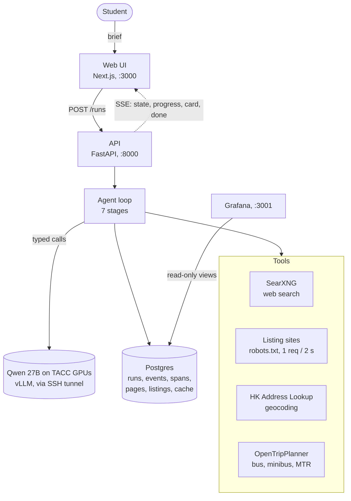
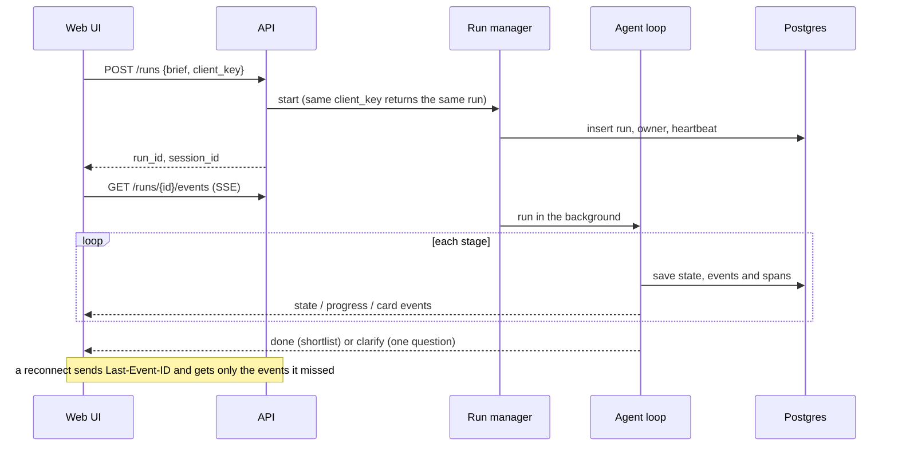
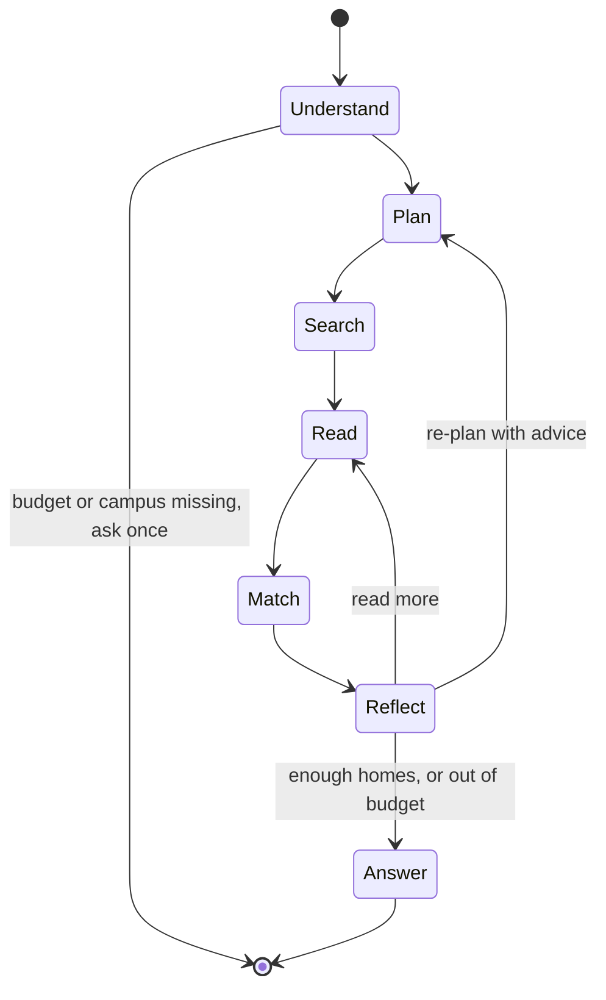

# Architecture

FlatJai turns a student's plain-language brief into a short list of real homes, each with its true
monthly and move-in cost, its commute to campus and its source. One rule shapes the whole design:
**the model decides, the tools state the facts.** The model reads the brief, plans searches, reads
listing pages and writes the explanation; every number a student sees (rent, cost, minutes) comes
from a page FlatJai fetched or from a tool's computation, and code checks it before it is shown.

## The system

FlatJai's model is Qwen3.8-27B, served by the course on TACC GPUs (vLLM). Everything else runs on
one machine with free components: Postgres, SearXNG, OpenTripPlanner and Grafana in Docker
(`compose.yaml`), the API and the web app. `./run.sh app` starts them together with the model's TACC
job and an SSH tunnel that forwards it to `localhost:8001` (profile `tacc-tunnel`); the evaluation
runs as a TACC job next to the service (`./run.sh suite`, profile `tacc`). Without TACC access,
Qwen3 8B through Ollama on the same machine stands in (profile `local`). See [tacc.md](tacc.md).

## One run, end to end

A run is a background task, not a request: closing the tab does not stop it, and the event stream
can be picked up again from any point. After every stage the state is saved, so a run interrupted
by a crash or restart continues from its last finished stage (`agent/runs.py`). Each server process
has an owner id and refreshes a heartbeat on its runs every 10 s; another process takes a run over
only when that heartbeat is older than 45 s, so a dev server never steals a run an evaluation is
still executing.

## The agent loop

| Stage | Who decides | What happens |
|---|---|---|
| Understand | model + code | Brief to a typed `Profile` (budget, campus, commute limit, room or flat, move-in). Numbers must appear in the brief. A missing budget or campus may trigger one question, never twice. |
| Plan | model | Areas and search wording; code drops repeats and falls back to the campus's areas if the call fails. |
| Search | code | SearXNG per readable portal; list pages are opened for their listing links. Blocked sites are dropped before any fetch. |
| Read | model + code | Fetch (cached), extract a `Listing` with an evidence quote per field, check every quote is on the page, compute cost, place the home and route its commute. A card streams as soon as a home fits. |
| Match | code | Hard limits in code (rent, room type, bedrooms, commute, move-in), duplicates across sites, and relaxations with real numbers when nothing fits. |
| Reflect | code + model | Code ends the search when enough homes fit or a budget runs out; otherwise the model chooses read more, re-plan (with advice) or answer. |
| Answer | model + code | The model ranks and explains; code drops any sentence whose number is not one of that home's facts. If the call fails, a code ranking is used: a run always ends with an answer. |

Budgets per run: 40 model calls, 60 fetches, 3 plan rounds and a time limit (`RUN_MAX_SECONDS`,
90 s by default, 240 s on a laptop). When one runs out the loop goes straight to Answer.

## Where each fact comes from

| What the student sees | Source | Checked by |
|---|---|---|
| Rent, size, bedrooms, address | the listing page, with a quoted evidence span | `agent/verify.py`: the quote must be on the page and contain the number; an unsupported rent rejects the listing |
| Monthly and move-in cost | `tools/cost.py` (deposit, first month, agent fee, management fee) | pure function, assumptions stated on the card |
| Commute minutes and route | OpenTripPlanner journey, else an MTR-graph estimate (`tools/transit.py`) | the evaluation compares against the router |
| "Fits your budget", "within 40 min" | `agent/match.py` | code only, never the model |
| Reasons and summary | the model (`explain`) | `agent/answer.py` drops sentences with unsupported numbers or superlatives |

The E2 ablation `model_facts` shows why: when the model states cost and commute itself, 24% of shown
homes break a limit and every cost is understated (8B: move-in by a median HK$18,900). See
[evaluation.md](evaluation.md).

## Tools

| Tool | Does | Notes |
|---|---|---|
| `search.py` | query to candidate URLs via SearXNG | free, self-hosted, no API key |
| `fetch.py` | URL to cleaned page text | obeys robots.txt, one request per 2 s per domain, never retries a bot challenge |
| `extract.py` | page to `Listing` (typed model call) | cached per page hash, extractor version and model |
| `preview.py` | rent and district from list-page cards | skips homes that surely cannot fit before spending a model call |
| `geocode.py` | building or district to coordinates | HK Government Address Lookup Service; cached permanently |
| `otp.py`, `transit.py` | home to campus journey | OpenTripPlanner with HK bus, minibus and an MTR feed built from MTR Open Data; offline estimate when OTP is down |
| `cost.py` | listing to monthly and move-in cost | Hong Kong customs: 2-month deposit, first month ahead, half-month agent fee |
| `portals.py` | which sites may be read | Centaline, uhomes and Amber are read; sites that block bots or forbid reuse are never fetched |

Every tool call goes through a cache (`tools/cache.py`) and is recorded as a span with its latency
and whether it hit. `FJ_OFFLINE=1` makes the cache the only source: the evaluation runs on a frozen
snapshot of the market (`data/snapshot-*.tar.zst`) and never touches a listing site.

## The model client

`model_client.py` is the only way to call a model. `typed_call()` sends a JSON schema generated from
a Pydantic class, validates the reply and gives the model one repair retry with the validation
error. It speaks the OpenAI-compatible API, so Ollama, LM Studio and vLLM all work; profiles live
in `backend/models.yaml`: `tacc-tunnel` (Qwen3.8-27B, AWQ INT4 on 2 GPUs, through the tunnel; the
default), `tacc` (the same service from inside a TACC job) and `local` (Qwen3 8B, 16K context,
thinking off, through Ollama; the fallback without TACC).

## Storage

| Table | Holds |
|---|---|
| `sessions`, `messages` | a chat: the profile so far, the questions already asked, the turns |
| `runs`, `events` | one run per turn, its saved state, owner and heartbeat; every event with its sequence number (SSE replay) |
| `spans` | the trace: one span per stage, model call and tool call, with timing and tokens |
| `pages`, `listings`, `shortlist_items` | fetched pages (raw bytes in `data/blobs/` by SHA-256), extractions, each run's shortlist |
| `cache` | search, geocode and route answers |

Schema changes go through Alembic (`backend/migrations/`). Tests run on SQLite with the same models.

## Observability

Every span is in Postgres, so two views read the same data:

- the **run inspector** (`/runs/{id}` in the UI): one run's stages, model calls with their prompts
  and replies, and tool calls;
- the **Grafana dashboard** (http://localhost:3001): all runs, time per stage, model and tool
  latency, cache hits and the scored suite, Qwen 8B and 27B side by side. `make obs` builds the
  read-only views in schema `obs` (`infra/grafana/load.py`); the dashboard is generated by
  `infra/grafana/build.py`.

## Code map

| Path | What |
|---|---|
| `backend/src/flatjai/api.py` | HTTP API and SSE endpoint |
| `backend/src/flatjai/agent/` | the loop (`loop.py`), one module per stage, `runs.py` (run manager), `events.py`, `verify.py`, `ablations.py` |
| `backend/src/flatjai/tools/` | the tools above |
| `backend/src/flatjai/storage/` | SQLAlchemy models, the store, the blob store |
| `backend/src/flatjai/model_client.py`, `tracing.py`, `config.py` | model calls, spans, settings |
| `web/src/` | Next.js UI: brief, live progress, cards with map, run inspector |
| `eval/` | the query suite, baselines B0 and B1, the scorer |
| `infra/` | SearXNG, OpenTripPlanner, Ollama, Grafana and the TACC job |
| `scripts/` | snapshot export and import, E2 and E3 runners, the TACC tunnel, MTR data builders |
| `docs/decisions/` | the design decisions, one file each |
